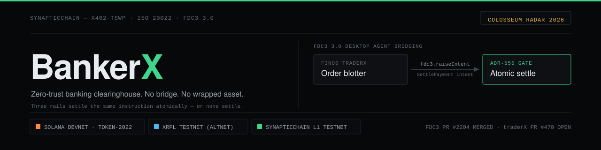

# Synaptic FX Terminal — BankerX+

> **All-In-One Institutional Desktop · Trilateral Atomic Rails · FINOS FDC3 3.0**

[](https://finos.org)
[](https://fdc3.finos.org)
[](https://www.iso20022.org/)
[](https://datatracker.ietf.org/doc/draft-shabazz-http-x402-tswp/)
[](https://www.iana.org/assignments/tls-extensiontype-values/)
[](https://github.com/finos/traderX/pull/470)
[](https://github.com/finos/FDC3/pull/2204)
[](https://github.com/finos/OpenEAGO/pull/65)
[](#license)

<p align="center"></p>

---

## Live Entry — Colosseum Radar Submission

Everything in this repository runs live — **BankerX+ is the desktop of record** (as of
2026-10-20 it serves at terminal, bankerx, bankerxplus AND traderx hostnames; the separate
traderX blotter UI was retired as redundant — its FINOS conformance lineage lives in the
traderX repo's `feature/016…` branch and PR #470):

| Path | What it is |
|---|---|
| [terminal.synapticchain.xyz](https://terminal.synapticchain.xyz) | **BankerX+ desktop of record** — full institutional desk, run the judge path below |
| [traderx.synapticchain.xyz](https://traderx.synapticchain.xyz) | The same desktop (estate consolidation: this hostname now serves BankerX+) |
| [explorer.synapticchain.xyz](https://explorer.synapticchain.xyz) | Evidentiary block explorer — invariant stamps, 44-method node-honesty coverage matrix, checkpoint proof pages |
| [`/`](https://colosseum.synapticchain.xyz/) | Sovereign clearinghouse console — live settlement desk |
| [`/demo`](https://colosseum.synapticchain.xyz/demo/) | Nine-stage live-fire settlement demo across all three rails |
| [`/can`](https://colosseum.synapticchain.xyz/can/) | Continuous Atomic Netting on the 400 ms estate window, live |
| [`/brief`](https://colosseum.synapticchain.xyz/brief/) | Position brief — the architecture and the case |
| [`/milestones`](https://colosseum.synapticchain.xyz/milestones/) | Shipped-scope milestone receipts with live evidence |

For the zero-setup verification path, see [`JUDGES_FLOW.md`](JUDGES_FLOW.md).

---

## Registered Research — 24 CERN Zenodo DOIs

| ID | DOI | Title |
|---|---|---|
| SYN-TD-001 | [](https://doi.org/10.5281/zenodo.22979715) | X402-TSWP Core Protocol — Typed Settlement Wire Framing |
| SYN-TD-002 | [](https://doi.org/10.5281/zenodo.22983522) | Sub-8ms Hardware Enclave Pre-Flight Gate (ADR-555) |
| SYN-TD-003 | [](https://doi.org/10.5281/zenodo.22994745) | Bridge-Free Trilateral Rail Settlement (Solana / XRPL / L1) |
| SYN-TD-004 | [](https://doi.org/10.5281/zenodo.22996200) | Parametric 256-Lane Watermark Nonce Architecture (ADR-062) |
| SYN-TD-005 | [](https://doi.org/10.5281/zenodo.22996628) | Atomic PTB Lifecycle Codec Pipelining |
| SYN-TD-006 | [](https://doi.org/10.5281/zenodo.23000701) | **Master L1 Sovereign Clearinghouse Umbrella Architecture** |
| SYN-TD-007 | [](https://doi.org/10.5281/zenodo.23002617) | Continuous Atomic Netting (CAN) Protocol |
| SYN-TD-008 | [](https://doi.org/10.5281/zenodo.23002720) | Zero-Knowledge ISO 20022 Confidential Clearing |
| SYN-TD-009 | [](https://doi.org/10.5281/zenodo.23002771) | Hardware-Attested Enclaves — ADR-555 Full Specification |
| SYN-TD-010 | [](https://doi.org/10.5281/zenodo.23003928) | **Amdahl Circumvention / 256-Lane SMR (S=38.56×)** |
| SYN-TD-011 | [](https://doi.org/10.5281/zenodo.23038493) | Financial PTB Wire Standard (SYN-FPS-2026-001) |
| SYN-TD-012 | [](https://doi.org/10.5281/zenodo.23041137) | ZKO State Attestation & Atomic RWA DvP Clearing |
| SYN-TD-013 | [](https://doi.org/10.5281/zenodo.23041557) | Mobile P2P Low-Bandwidth Settlement (Sub-160B Framing) |
| SYN-TD-014 | [](https://doi.org/10.5281/zenodo.23041910) | Off-Grid LoRa Mesh & Delay-Tolerant Radio Wire Framing |
| SYN-TD-015 | [](https://doi.org/10.5281/zenodo.23042571) | Sovereign DPI Blotter Blueprint (Real-Time Fiscal Ingestion) |
| SYN-TD-016 | [](https://doi.org/10.5281/zenodo.23226115) | Zero-Custody Autonomous Agent Settlement Rails |
| SYN-TD-017 | [](https://doi.org/10.5281/zenodo.23226067) | Single-Call Zero-Seed Multi-Ledger Cryptographic Provisioning |
| SYN-TD-018 | [](https://doi.org/10.5281/zenodo.23226408) | Bilateral FX Market-Making with Performance Bond Escrows |
| SYN-TD-019 | [](https://doi.org/10.5281/zenodo.23226479) | Sovereign Stripe-Compatible PaymentIntent REST Emulator |
| SYN-TD-020 | [](https://doi.org/10.5281/zenodo.23226579) | Decoupled Multi-DLT Settlement Architecture on Token-2022 |
| SYN-TD-021 | [](https://doi.org/10.5281/zenodo.23373168) | CAN Temporal Shell — Fail-Closed Continuous Netting Coordinator |
| SYN-TD-022 | [](https://doi.org/10.5281/zenodo.23427407) | Type-State Enforced Temporal Shells — Formal Verification (TLA+/Quint, 0 violations) |
| SYN-TD-023 | [](https://doi.org/10.5281/zenodo.23427410) | Watermark-Bitmap Lanes — Gap-Tolerant Nonce Formal Laws (TLA+/Quint, 0 violations) |
| SYN-TD-024 | [](https://doi.org/10.5281/zenodo.23427412) | The Cursor Never Leads the Ledger — Checkpoint-Replay Catchup Formal Laws |

> All 24 DOIs are live-registered on CERN Zenodo (Master Umbrella DOI: [10.5281/zenodo.23227024](https://doi.org/10.5281/zenodo.23227024)). The full protocol specification lives in [Synaptics-Lab/Synaptic-Source → apps/x402-tswp](https://github.com/Synaptics-Lab/x402-tswp). SYN-TD-022 through SYN-TD-024 are machine-checked formal verification packs (Quint 0.33.0 simulation + Apalache 0.62.1 bounded model-checking, zero violations), written directly from the implementation.

---

### Peer-reviewed white papers (in this repository)

- [FINOS FDC3 PR #2204 — the switch was flipped](FINOS_FDC3_PR2204_THE_SWITCH_WAS_FLIPPED.pdf) — the ISO 20022 payment-intent merge inside Linux Foundation FINOS FDC3 (3 pages, October 2026).
- [SynapticChain & BankerX — Sovereign Settlement Stack: complete architectural deep dive](SYNAPTICCHAIN_BANKERX_COMPLETE_ARCHITECTURE_DEEP_DIVE.pdf) — from the L1 Rust kernel to the card rail (3 pages, October 2026; 23-crate stack, 3,347 Rust tests).
- [FX settlement architecture comparison](FX_Settlement_Architecture_Comparison.png) — reference diagram.

## Verified Live Telemetry

| Metric | Value | Source |
|---|---|---|
| Enclave pre-flight gate | **< 1.85 ms** | ADR-555, SIMD Bloom filter, mlock non-pageable |
| Sanctioned-debtor refusal | **1.37 ms** | HTTP 403 pre-wire, zero drain |
| FDC3 instant raise → populated desk | **8 ms** | `raiseResult {"ms":8,"ok":true}` on the live desk instance (2026-10-20) |
| Trilateral settle round trip | **7–15 s** | Token-2022 commit → XRPL evidence → L1 proof → pacs.002 `Acsc` |
| 256-lane all-lane settle | **1,280/1,280** | Live L1 testnet, all 256 lanes, 1,286 receipts/checkpoint (2026-10-20) |
| Hostile reversed-nonce gap-fill | **2,560 txs GREEN** | 2,560 transactions in deliberately reversed nonce order (2026-10-20) |
| 256-lane blast throughput | **4,056.2 TPS** | `stunt_5wallets_256lanes.py`, 1,280 txs / 0.316s |
| Parallel speedup | **S = 38.56×** | Gustafson-Barsis, p = 97.78%, 0 collisions |
| Signature throughput | **10,203 sigs/sec** | Live cluster, 5-wallet parametric burst |

---

## What Is This

**BankerX+** is the **all-in-one institutional settlement desktop** in the **Synaptic FX
Terminal** suite. It is FDC3 3.0 desktop-agent live (per [FINOS TraderX](https://github.com/finos/traderX) interop and the merged `StartPayment` intent, FDC3 PR #2204 in `finos/FDC3:main`): a dealer raises a `StartPayment` intent and the clearing desk **opens itself already populated** — the desktop agent re-targets the running desk instead of spawning a tab, measured at **8 ms** end-to-end. The desk's executor-of-record then atomically executes the payment across three independent rails.

> **Colosseum Hackathon Judges:** See [`JUDGES_FLOW.md`](JUDGES_FLOW.md) for the 30-second fast path, live Token-2022 proof, and keyless enclave verification.  
> **Watch Live Demos:** [90-Second Technical Demo](https://youtu.be/ZMCEc2Jge4c) · [3-Minute Pitch Video](https://youtu.be/o92UFXH7dI4)  
> ⚡ **For Autonomous AI Agents:** See [`SKILL.md`](SKILL.md) for 10-second zero-cost auto-onboarding, keyless settlement, and 400ms continuous netting streams.  
> **The desktop of record:** [https://terminal.synapticchain.xyz](https://terminal.synapticchain.xyz) (also served at [traderx.synapticchain.xyz](https://traderx.synapticchain.xyz) — 2026-10-20 estate consolidation: the separate traderX blotter UI was retired as redundant; the FINOS conformance lineage remains in the traderX repo's `feature/016-post-trade-settlement-bankerx` branch and PR #470).

**No bridge. No wrapped asset. Three rails settle the same instruction atomically or none settle.**

---

## Trilateral Settlement Architecture

```
FDC3 blotter (any FDC3 desktop — TraderX lineage, PR #470)
    │
    │  fdc3.raiseIntent("StartPayment", fdc3.payment context)
    │  ◄── FDC3 3.0 Desktop Agent Bridging (instant-retarget, 8 ms) ──►
    ▼
BankerX+ (All-In-One Settlement Desktop)
    │
    │  ADR-555 Enclave Pre-Flight  <1.85ms
    │  · 65,536-bit SIMD Bloom filter sanctions screen
    │  · Mantis Invariant 9: ΣDebits ≡ ΣCredits (Δ=0)
    │  · WOTS+ 67-chain post-quantum attestation
    │  · Fail-closed 0x24 abort
    │
    ├──► Solana Token-2022
    │      RequiredMemoTransfers · ISO 20022 UETR embedded
    │      sysvar::instructions byte-exact PTB introspection
    │      Atomic commit-or-rollback · trilateral receipt 7–15 s
    │
    ├──► XRPL Altnet
    │      SHAMap DENSE-16 · memo field 0x58343032
    │      Parallel attestation rail · no oracle dependency
    │
    └──► SynapticChain L1
           SCBFT consensus · ADR-062 256-lane rendezvous hashing
           Sliding 256-bit bitmask watermark nonces
           4,056.2 TPS · S=38.56× · 0 collisions
```

---

## X402-TSWP Protocol — The Atomic PTB Pipeline

The [X402-TSWP protocol](https://github.com/Synaptics-Lab/x402-tswp) sequences 7 typed settlement instructions inside a single Solana PTB:

```
X402G → X402M → X402L → X402B → X402E → X402W → X402N
 Gate    Escrow   Lane   Bond   UETR    Settle  Readback
```

Each instruction introspects the prior via `sysvar::instructions::load_instruction_at_checked`. The entire pipeline commits or rolls back atomically. IETF-drafted. IANA ALPN registered (`0x78 0x34 0x30 0x32`).

→ **Full specification:** [Synaptics-Lab/Synaptic-Source/apps/x402-tswp](https://github.com/Synaptics-Lab/x402-tswp)

---

## FINOS Open-Source Footprint

| Contribution | Status |
|---|---|
| [TraderX PR #470](https://github.com/finos/traderX/pull/470) — FDC3 BankerX connectivity | Open |
| [FDC3 PR #2204](https://github.com/finos/FDC3/pull/2204) — StartPayment intent & `fdc3.payment` context | **MERGED into `finos/FDC3:main`** (2026-10-08) |
| [OpenEAGO PR #65](https://github.com/finos/OpenEAGO/pull/65) — Settlement rail integration | Open |
| [FDC3 Issue #2250](https://github.com/finos/FDC3/issues/2250) — Desktop Agent Bridging spec gap | Open |
| [CCC Issue #1227](https://github.com/finos/common-cloud-controls/issues/1227) — Enclave control mapping | Open |

---

## Quickstart

```bash
# 1. Launch the BYOK enclave daemon
node enclave/daemon.mjs

# 2. Start BankerX
cd client && npm install && npm run dev
# → http://localhost:3000

# 3. Open TraderX alongside it
# → https://traderx.synapticchain.xyz
# FDC3 HTTP relay auto-connects at /api/fdc3/intent + /api/fdc3/status (400ms poll)
```

---

## Standards & Regulatory Alignment

- **FDC3 3.0** — Desktop Agent Bridging Specification (FINOS ratified)
- **ISO 20022 CBPR+** — pacs.008.001.08 byte-exact XML synthesis
- **IETF** — `draft-shabazz-http-x402-tswp-00`
- **IANA** — ALPN ID `0x78343032`, HTTP Field registrations (Issues #62, #63)
- **CERN Zenodo** — 24 registered DOIs, peer-review-calibre research corpus (SYN-TD-001 through SYN-TD-024; 022–024 are machine-checked formal verification packs)
- **EU DORA** — ICT resilience aligned (hardware enclave, fail-closed abort)

---

## License

**ALL RIGHTS RESERVED** — see [LICENSE](LICENSE). This repository is published
for evaluation and verification: read, build, run, and evaluate the desk;
redistribution, resale, and derivative commercial use require written
permission. The **standards surface** of the work is open to all — any party
may implement the FDC3 3.0 `StartPayment` intent / `fdc3.payment` context
vocabulary (per FINOS PR #2204) and the two-tier adapter interface on their
own settlement backend. This license governs this repository's particular
implementation only.

---

## Verification record — SynapticChain estate (2026-10-12)

Measured on the live tree (fresh grep census 2026-10-12); every live receipt below was
run twice unless noted.

- **3,347 Rust test functions** across the 23-crate L1 workspace (2,713 across 554 `.rs`
  files, 226,550 LOC — consensus 694, synaptic-types 373, state 299, compiler 247,
  p2p 221, node 220, vm 180) **plus** 634 across the estate's Rust service programs
  (CAN executor, Solana escrow program, verification suite, fuzz targets).
- **178 property-test macros** (`proptest`/`quickcheck`); `criterion` benchmark suites
  for consensus, node, and storage.
- **1,161 SDK test functions** (Python + TypeScript SDKs, 37 test files) and ~310 more
  across the gateway, terminal, and service suites — **>4,800 test
  functions/assertions platform-wide**.
- **+1 TradFi-facing rail**: Stripe-shaped card rail over Solana OUSD (TD-019 Sovereign Stripe) — Stripe-compatible honest shim, E2E ×2 GREEN ([syn-stripe-bridge](https://github.com/Synaptics-Lab/syn-stripe-bridge)).
| Suite | Score |
|---|---|
| Formal invariant verification (FIV v4.4) | 12/12 invariants PASS |
| FINOS Open Source Maturity Model | Level 5 — Grade A+ — 24/24 |
| Colosseum app preflight (edge-mode, strict TLS) | 21 PASS / 0 FAIL ×2 |
| finITe — FINOS conformance suite vs our agent | 131/132 ×2 (the 1 miss was a DOM-evaluation artifact of the harness itself, since resolved in CI) |
| Interledger devnet E2E (two-ledger loop) | 13/13 ×2 |
| FDC3 StartPayment → clearinghouse bridge | 15/15 ×2 |
| R15 MCP m2m corridors | 81/81 ×2 |
| R15 watermark rolling settlement | 24/24 ×2 |
| R13 multi-rail (Solana + XRPL mixed) phase 10 | 14/14 ×2 |
| Corridor 17 (sUSD/cTZS) | 24/24 ×2 |
| Stripe-compatible card-rail shim (honest-core :8092, `syn-stripe-bridge`) | E2E ×2 GREEN, F1–F9 closed, custodian spend-cap 9/9 ×2 ([syn-stripe-bridge](https://github.com/Synaptics-Lab/syn-stripe-bridge)) |
| 10-stage live wire loop (FDC3 intent → clearinghouse seal → dual-rail evidence → margin settlement → finalize → outbound pacs.008 render) | ALL 11 stages GREEN ×2, 2026-10-12 (sessions 102/103 sealed; same-UETR pacs.008.001.08 rendered) |
| Uhuru/UTA audit battery | 17/17 ×2 (remediation + SSOT-frame); UTA-2026-10-03-003 verdict PASS-WITH-NOTES |
| Daily preflight + phase ladder (cron) | 2 GREEN pairs/day since 2026-10-08 |

Run it without the source: [synaptic-open](https://github.com/Synaptics-Lab/synaptic-open) —
production node binaries, genesis, example SynapticLang contracts, and runnable local/public probes
(local node 3/3 ×2, public surface 7/7 ×2).

Live consoles: [terminal.synapticchain.xyz](https://terminal.synapticchain.xyz) ·
[colosseum.synapticchain.xyz](https://colosseum.synapticchain.xyz). Full record mirrors publicly at
[github.com/Synaptics-Lab](https://github.com/Synaptics-Lab) (the org profile carries the same table).
